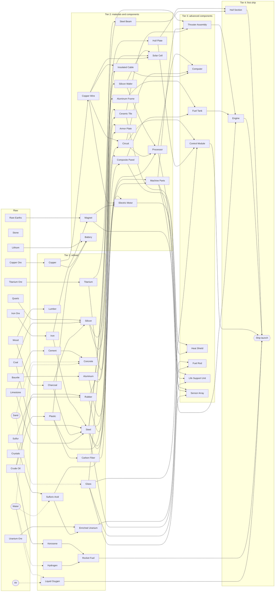

# Resource Tree and Economy Plan

- Status: Implemented
- Id: 2611141757-resource-tree
- Depends-on: none

## Summary

Proposes the full resource tree (raw, refined, materials, advanced components, and ship parts) and
the economy systems around it: storage limits, capacity resources (Power, Water, Sand), local
buffers on buildings, a single hub network rooted at the HQ, and late-game renewable sources that keep finite
deposits from stranding the player. It is a planning changeset: it lands as an update to
`docs/game-plan.md` and splits the build into the follow-on changesets listed at the end.

**Scope.** This changeset decides the resources (what exists, what feeds what, how each is
stored and supplied) and the system rules around them. Buildings are named only to say where a
recipe happens. Every building's construction cost, speed, power draw, tier placement, footprint,
and model, and every number marked as a placeholder, is decided by the follow-on changeset that
builds it.

## Motivation

Today there are eight raw resources, two refined ones, one unlimited global stockpile, and no
power. The chain toward the first ship needs about ten more items, and Part B will need many more.
Before adding them one at a time we want the shape agreed: which resources exist, how they are
stored, what limits throughput, and how the map stays playable once nearby deposits run out.
Storage, power, and connection change every building, so they are decided together here even
though they ship separately.

## Design

### 1. Supply models

Every resource follows one of two supply models. This is the idea that keeps the rest consistent.

| Model | What it is | Examples | How a building uses it |
|---|---|---|---|
| **Stored** | Counted units held in storage | Wood, Iron Ore, Steel, Circuit, Rocket Fuel | Consumed per cycle |
| **Capacity** | An available amount that providers put on a network; never stockpiled | Power, Water, Sand | Reserved while the building runs, released when it stops |

- Finite or infinite describes the **source**, not the model. A Quarry produces Stone forever, but
  Stone is still Stored. Capacity is for resources whose quantity is meaningless and whose rate of
  access is the only constraint.
- Water and Sand are `TerrainSourced` and Stored today (nothing produces them yet); they become
  Capacity.

#### Fuel

Fuel is Stored, but a building uses it differently from a recipe input. A **fuel-burning
building** (the Smelter, the Burner Generator) has a fuel slot: it takes one unit of fuel, burns it
for that fuel's **burn time** while it works, then takes the next. Recipe inputs, by contrast, are
used up per cycle.

- Each fuel has its own burn time, so better fuel is worth the effort (placeholders: Wood 10 s,
  Charcoal 30 s, Coal 40 s). Charcoal turns plentiful, renewable Wood into a fuel close to Coal.
- A fuel-burning building has a fuel picker (see Input pickers below) defaulting to **Best**: the
  fuel with the longest burn time that storage holds, falling back to the next when it runs out.
- A unit being burned is spent: switching off or destroying the building does not return it.
- The same item can be a fuel in one building and a material in another: Coal is fuel in the
  Smelter and a material (an input used up per cycle) in Steel and Silicon.

#### Input pickers

Any recipe input with alternatives (Coal or Charcoal in Steel and Silicon) and any fuel slot gets
a **picker** in the building's panel: a dynamic default plus each alternative by name.

| Picker | Default | Rule the default follows | Example tooltip |
|---|---|---|---|
| Alternative material | **Auto** | whichever alternative storage holds more of, switching when that changes | "Auto: uses Coal (Coal 120, Charcoal 40)" |
| Fuel | **Best** | the longest-burning fuel storage holds, falling back when it runs out | "Best: burns Coal (40 s per unit)" |

- The tooltip on the default names what it will use now and why.
- Choosing a specific item uses only that one; the building stops with "Waiting for Charcoal"
  when it runs out.

Two cases to design for when they come up (none exists in the catalog yet):

- **Alternatives with different quantities**, such as 1 Coal or 2 Charcoal per Steel. Auto would
  then need a rule that weighs the quantity (for example, most cycles' worth in storage, not most
  units).
- **No sensible dynamic default.** When neither "more of" nor "best" means anything for a set of
  alternatives, the picker has no Auto or Best: a default alternative is picked when the building
  is placed, and the player changes it by hand.

### 2. Tiers and chains

A **tier** is a stage of the game: what the player can build once they reach it, and roughly which
power and building level it takes. It is **not** chain depth. Inside a tier, items can feed each
other in mini-chains of any length, and a tier-3 item may need several tier-2 steps in sequence:

```
Tier 2 (electronics):  Quartz ── Silicon ── Silicon Wafer ── Processor ──┐
                       Copper ── Copper Wire ── Circuit ─────────────────┼── Computer (tier 3)
                       Rare Earths ── Magnet ── Electric Motor ──────────┘
```

The catalog below gives each item a tier and lists its inputs, so the graph can be read from it
directly. Recipes and counts are placeholders for tuning.

### 3. Resource catalog

**Proposal** marks each item: **Have** (exists), **Keep** (recommended), **Maybe** (decide in
review), **Cut** (recorded so we know it was considered). Storage classes are defined in section 4.

#### Raw: finite deposits (tier 0)

| Resource | Storage | Biomes | Feeds | Proposal |
|---|---|---|---|---|
| Wood | Stockyard | Forest, Grassland, Swamp | construction, Lumber, Charcoal | Have |
| Stone | Stockyard | Highlands, Grassland | construction, Concrete, crushed to Sand | Have |
| Iron Ore | Stockyard | Grassland, Highlands | Iron | Have |
| Copper Ore | Stockyard | Highlands, Desert | Copper | Have |
| Coal | Stockyard | Highlands | Steel, burner fuel | Have |
| Crude Oil | Tank Farm | Desert, later Ocean | Kerosene, Plastic, Rubber | Have |
| Bauxite | Stockyard | Desert, Highlands | Aluminum | Keep |
| Limestone | Stockyard | Grassland, Highlands | Cement, steel flux | Keep |
| Quartz | Stockyard | Highlands, Tundra | Silicon | Keep |
| Titanium Ore | Stockyard | Ocean shore, Tundra | Titanium | Keep |
| Sulfur | Stockyard | Swamp, Volcanic | Sulfuric Acid, Rubber | Keep |
| Rare Earths | Vault | Tundra | Magnets, sensors | Keep |
| Uranium Ore | Vault | Tundra | fission fuel | Keep |
| Crystals | Vault | Volcanic | Jump Drive (and Part B's lens and shield upgrades) | Keep |
| Nickel Ore | Stockyard | Tundra | nothing once Stainless Steel and Superalloy were cut | Cut |
| Natural Gas | Tank Farm | Desert, Ocean (beside oil) | only a second source of Plastic | Cut |
| Tungsten Ore | Stockyard | Volcanic, Tundra | only an alternative to Titanium in Armor Plate | Cut |
| Lead, Tin, Zinc, Gold, Silver, Platinum, Graphite, Clay | | | each lacks a job no Keep resource already does | Cut |

That is 14 finite Keep types.

#### Raw: infinite sources

| Resource | Model | Source | Feeds | Proposal |
|---|---|---|---|---|
| Water | Capacity | Pump on ShallowWater or a river | Hydrogen and Liquid Oxygen, Concrete, Refinery cooling | Have (becomes Capacity) |
| Sand | Capacity | Collector on Sand; Rock Crusher (Stone) anywhere | Glass, Concrete | Have (becomes Capacity) |
| Power | Capacity | generators (section 5) | powered buildings | Keep |
| Lithium | Stored, Stockyard | Brine Well on Desert salt flats | Battery | Keep |
| Air products | Stored, Tank Farm | Air Separator, anywhere, no input | Liquid Oxygen | Keep (outputs listed under refined) |
| Salt, Latex | | | Salt only feeds Chlorine; synthetic Rubber covers Latex | Cut |
| Biomass | | Farm in Swamp | nothing: Plastic comes from Crude Oil and there is no Bio-fuel | Cut |

#### Refined (tier 1)

| Item | Inputs | Building | Storage | Proposal |
|---|---|---|---|---|
| Iron | Iron Ore | Smelter | Warehouse | Have |
| Kerosene | Crude Oil (Water capacity for cooling) | Refinery | Tank Farm | Keep |
| Rocket Fuel | Kerosene, Hydrogen | Fuel Plant | Tank Farm | Have (chain reworked, see below) |
| Copper | Copper Ore | Smelter | Warehouse | Keep |
| Steel | Iron, Coal or Charcoal, Limestone | Steel Mill | Warehouse | Keep |
| Glass | Sand | Glassworks | Warehouse | Keep |
| Lumber | Wood | Lumber Mill | Warehouse | Keep (planned as a building material; feeds no recipe) |
| Charcoal | Wood | Charcoal Kiln | Stockyard | Keep |
| Cement | Limestone | Kiln | Warehouse | Keep (feeds Concrete) |
| Concrete | Cement, Sand, Water | Mixer | Warehouse | Keep (planned as a building material; feeds no recipe) |
| Plastic | Crude Oil | Chemical Plant | Warehouse | Keep |
| Hydrogen | Water capacity, heavy Power | Electrolyzer (Hydrogen recipe) | Tank Farm | Keep |
| Liquid Oxygen | Water capacity and heavy Power early; (air) and Power later | Electrolyzer (Oxygen recipe), then Air Separator | Tank Farm | Keep |
| Aluminum | Bauxite (via Alumina), heavy power | Aluminum Smelter | Warehouse | Keep |
| Silicon | Quartz, Coal or Charcoal | Electric Furnace | Warehouse | Keep |
| Sulfuric Acid | Sulfur, Water | Chemical Plant | Tank Farm | Keep |
| Rubber | Crude Oil, Sulfur | Chemical Plant | Warehouse | Keep |
| Titanium | Titanium Ore, heavy power | Electric Furnace | Warehouse | Keep |
| Carbon Fiber | Plastic | Chemical Plant | Warehouse | Keep |
| Enriched Uranium | Uranium Ore, Sulfuric Acid | Enrichment Plant | Vault | Keep |
| Xenon | (air) | Air Separator | Tank Farm | Cut for now. Its purpose: propellant for an Ion Drive, a slow, efficient in-system engine. Revisit if in-system travel needs a step between Rocket Fuel and the Jump Drive |
| Stainless Steel | Steel, Nickel | Steel Mill | Warehouse | Cut: fed nothing. A real role would be cryogenic Fuel Tanks |
| Superalloy | Nickel, Tungsten | Electric Furnace | Warehouse | Cut: fed only Turbine Blade. A real role would be engine parts, or a Jump Drive material |
| Lubricant | Crude Oil | Refinery | Tank Farm | Cut |

#### The rocket fuel chain

Rocket fuel today is one step (Crude Oil to Rocket Fuel), and the earlier plan (Crude Oil, Water,
and Liquid Oxygen in one Refinery) put an oxidizer inside the fuel and Water in as an ingredient.
Following how kerosene rocket propellant is really made gives more stages without inventing any:

```
Crude Oil ── Refinery ───────────────── Kerosene ──┐
                                                   ├── Fuel Plant ── Rocket Fuel
Water ── Electrolyzer (Hydrogen recipe) ── Hydrogen ┘

Water ── Electrolyzer (Oxygen recipe) ─── Liquid Oxygen   (early)
(air) ── Air Separator ─────────────────── Liquid Oxygen   (later, the bulk source)
```

- **Rocket Fuel** is refined kerosene: the Refinery distills Kerosene from Crude Oil, and the Fuel
  Plant treats it with Hydrogen to strip out sulfur, which gives Hydrogen a job early.
- **One output per recipe.** The real processes have by-products (Plastic from the Refinery,
  Sulfur from the Fuel Plant, oxygen and hydrogen together from electrolysis), but two outputs
  raise a storage problem: what a building does when one output is full and the other is not. So
  every recipe has exactly one output, and the Electrolyzer has two recipes (Hydrogen or Liquid
  Oxygen), one chosen at a time.
- **The oxidizer is its own item.** A rocket carries fuel and oxygen in separate tanks, so the
  launch needs Rocket Fuel **and** Liquid Oxygen, both from the Tank Farm.
- **Infinite inputs, real cost.** Water is Capacity and air is everywhere, but splitting water and
  liquefying air both take a lot of power. That makes the power system the limit on fuel, which is
  true to life and does not need extra steps. Water leaves the recipe as an ingredient; the
  Refinery needs Water capacity for cooling instead.
- **Early to late.** The Electrolyzer's Oxygen recipe covers the first ship, so it needs no Air
  Separator. A launch needs far more oxygen than the Fuel Plant needs hydrogen, so the Air
  Separator arrives later as the cheaper bulk oxygen source (less power per unit).
- **Late-game fuel without oil (Maybe):** with abundant power (geothermal, fission), Hydrogen and
  Liquid Oxygen alone make a fuel from Water and power only, a renewable bypass for Crude Oil. It
  would need its own engine part, so it belongs with the Part B ship parts.

#### Materials and components (tier 2)

| Item | Inputs | Proposal |
|---|---|---|
| Hull Plate | Steel | Keep (planned) |
| Steel Beam | Steel | Keep (planned) |
| Copper Wire | Copper | Keep (planned) |
| Circuit | Copper Wire, Plastic | Keep (planned) |
| Insulated Cable | Copper Wire, Rubber | Keep |
| Machine Parts (gears, bearings, valves as one item) | Steel, Rubber | Keep |
| Silicon Wafer | Silicon | Keep |
| Processor | Silicon Wafer, Circuit, Sulfuric Acid | Keep |
| Magnet | Rare Earths, Iron | Keep |
| Electric Motor | Steel, Copper Wire, Magnet | Keep |
| Battery | Lithium, Copper, Plastic | Keep |
| Solar Cell | Silicon Wafer, Glass, Copper Wire | Keep |
| Composite Panel | Carbon Fiber, Aluminum | Keep |
| Ceramic Tile | Silicon, Aluminum (alumina) | Keep |
| Aluminum Frame | Aluminum | Keep |
| Armor Plate | Steel, Titanium | Keep |
| Turbine Blade | Superalloy | Cut (with Superalloy) |
| Pipe | Steel | Cut (fold into Machine Parts) |

#### Advanced components (tier 3)

| Item | Inputs | Proposal |
|---|---|---|
| Control Module | Circuit, Hull Plate, Glass | Keep (planned) |
| Computer | Processor, Circuit, Insulated Cable | Keep |
| Thruster Assembly (chamber and nozzle) | Titanium, Machine Parts, Ceramic Tile | Keep |
| Fuel Tank | Aluminum Frame, Composite Panel | Keep |
| Heat Shield | Ceramic Tile, Composite Panel | Keep |
| Fuel Rod | Enriched Uranium, Steel | Keep |
| Life Support Unit | Electric Motor, Machine Parts, Glass | Keep |
| Sensor Array | Processor, Magnet, Glass | Keep |
| Laser Lens | Crystals, Glass | Cut: returns in Part B as an optional ship upgrade (Laser Turret) |
| Shield Emitter | Crystals, Computer, Magnet | Cut: returns in Part B as an optional ship upgrade (Shield Generator) |

#### Ship parts and consumables (tier 4)

The first ship's set is **Keep**; the rest depends on Part B's style (still open), so it is all
**Maybe** for now.

- **First ship (Keep):** Hull Section (Hull Plate, Steel Beam), Engine (Thruster Assembly, Fuel
  Tank, Machine Parts), Control Module, Rocket Fuel, Liquid Oxygen. The Engine moves up from its placeholder
  recipe (Steel, Copper Wire, Circuit) to use the tier-3 parts.
- **Structure:** Armored Hull Section, Cargo Bay, Docking Clamp
- **Propulsion:** two stages of travel. **Rocket Fuel** engines move ships within a solar system;
  a later **Jump Drive** moves them between solar systems and needs more exotic fuels and
  materials (Crystals today; the rest is for the jump drive's own changeset). Maneuvering
  Thrusters sit alongside either. The Ion Drive (Xenon) and Fusion Drive are out of this model
  for now.
- **Power:** Solar Array, Battery Bank, Fission Reactor (Fuel Rods)
- **Command and crew:** Sensor Suite, Comms Array, Life Support Module, Crew Quarters
- **Weapons and defense:** Mass Driver, Missile Launcher, Point Defense. The Laser Turret (Laser
  Lens) and Shield Generator (Shield Emitter) are optional ship upgrades for Part B to design.
- **Utility:** Mining Laser (asteroid ore back into Part A, see section 9), made without a lens:
  Sensor Array, Machine Parts, Thruster Assembly (placeholder)
- **Consumables:** Ammunition, Missiles, Fuel Rods, Repair Kits

#### The tree as a chart

Every Have and Keep item and what it feeds, from raw resources to the first ship launch (buildings
left out). Rounded nodes are Capacity resources and dashed arrows are Capacity requirements; an
item with two arrows from Coal and Charcoal takes either. Items with no arrow out (Lumber,
Concrete, Battery, Solar Cell, Armor Plate, Computer, Heat Shield, Fuel Rod, Life Support Unit,
Sensor Array, Crystals) are building materials or feed Part B parts still to be designed.



### 4. Storage

#### Raw resources: per-type limits, expanded by class

Each Stored raw resource has its own limit, and each has a **storage class** and a **step**: how
much one storage building of its class adds for that type. A building raises every type in its
class by that type's step.

| Class | Building | Holds | Example steps (placeholders) |
|---|---|---|---|
| Bulk | Stockyard | solid raws and Charcoal | +400 Stone, +300 Wood, +200 Iron Ore |
| Fluid | Tank Farm | liquids and gases, raw and refined | +500 Crude Oil, +300 Rocket Fuel |
| Secure | Vault | radioactive and precious | +50 Uranium Ore, +50 Crystals |

So one Stockyard adds a different amount of Wood than of Stone, as wanted, without 15 building
types.

- **Silo (boost):** on top of the class buildings, a Silo holds one chosen resource and adds a
  large step for that type only (say 4x its class step). It is for the player who knows Stone is
  the bottleneck. The Silo comes first (Wood only); the class buildings follow later in the same
  tier (Wood and, likely, Iron).
- Rejected: one storage building per resource (Wood Shed, Stone Yard, ...), about 20 building
  types that differ only in a number.

#### Manufactured goods: shared Warehouse by Cargo

- Every solid tier-1-and-up item has one number, its **Cargo** (placeholders: Iron 1, Circuit
  0.25, Steel Beam 4, Hull Section 20). A Warehouse adds a pool of Cargo (say 500) shared by all of
  them. The same unit can carry into Part B as a ship's hold.
- Fluids (Rocket Fuel, Hydrogen, Liquid Oxygen, Sulfuric Acid) use the Tank Farm, and Enriched
  Uranium the Vault, so the Warehouse holds only solids.

#### Base storage, full storage, and the top bar

- An **HQ** (the landing craft, placed free at spawn) gives base capacity in every class and a
  small Warehouse pool, so the early game needs no storage building. It is also the first hub
  (section 7).
- Gathering or production that cannot fit goes to the producer's local buffer (section 6); a
  processor whose output cannot fit stops with "Storage full".
- The top bar cannot show 20+ raw types. It shows **pinned** resources: the current raw set by
  default, pinned or unpinned from the inventory panel. Capacity resources show as demand over
  supply ("Power 45 / 100"), colored by brownout state (section 5).

### 5. Capacity resources: Power, Water, Sand

- Online providers add to the network's available amount; a switched-on online consumer draws its
  requirement. A Glassworks needs 2 Sand: two small Sand Collectors (1 each) or one large one (4)
  covers it.
- **Shortage rule: double brownout, then blackout.** Demand is the sum of every switched-on
  consumer's requirement on the network; **overload** is how far demand exceeds supply
  (`demand / supply - 1`). Each consumer slows by twice the overload:

  | Overload | Consumer speed |
  |---|---|
  | 0% or less | 100% |
  | 10% | 80% |
  | 20% | 60% |
  | 25% | 50% |
  | over 25% | 0%: blackout, every consumer of that resource stops |

  Demand counts switched-on consumers whether or not they are working at the moment. Otherwise a
  blackout would stop every consumer, drop demand to zero, restart them all, and flap each tick.
  So a blackout holds until the player adds supply or switches buildings off, and the HUD says so
  ("Blackout: Power 140 / 100").
- Water and Sand use the same rule as Power.
- **Display.** Every capacity readout (top bar, building panel, placement tooltip) shows demand
  over supply, colored by state:

  | State | Demand | Example | Color |
  |---|---|---|---|
  | Normal | up to supply | 5 / 10 | normal text |
  | Warning (brownout) | over supply, up to 25% over | 11 / 10 | yellow |
  | Danger (blackout) | more than 25% over | 15 / 10 | red |

  `ui-style.md` has a `Danger` token (for destructive buttons) but no warning color, so the power
  changeset adds a `Warning` token and reuses `Danger` for blackout.
- **Which buildings take power.** Tier-0 buildings take none and are slow; tier 1 and up need
  power and are faster, **except** buildings whose role never needs it at any tier: storage
  (Stockyard, Tank Farm, Vault, Silo, Warehouse), hubs, and generators. This is a flag on the
  building definition, not a rule by type. Extractors get both forms:

  | Building | Tier | Power | Speed |
  |---|---|---|---|
  | Lumber Camp | 0 | 0 | 0.75 (today) |
  | Lumber Mill | 1 | 5 | ~2 |
  | Mine | 0 | 0 | 0.75 (today) |
  | Drill Rig | 1 | 10 | ~2 |
  | Smelter (burns fuel: Coal, Charcoal, or Wood) | 0 | 0 | today's rate |
  | Electric Furnace | 1 | 20 | faster, also Silicon and Titanium |
  | Steel Mill, Refinery, Chemical Plant | 1 | 25 to 30 | |
  | Assembler | 1 | 15 | |

- **Providers** (placeholders): Water Wheel 20 (Straight river cell, free to run), Burner
  Generator 100 (burns Coal, Wood, or Charcoal), Oil Generator 200, Solar Array 50, Geothermal Tap
  500 (beside Lava), Fission Reactor 2000 (burns Fuel Rods).

### 6. Local buffers and manual collection

- Every building that produces Stored items has a small **local buffer** (say 20 units, or the
  output of a few cycles).
- **Collectors** (extractors and other raw producers) always fill their buffer. Raw resources reach
  storage only by hand or by truck (section 7), until Material Transfer lets the network carry
  them. A full buffer stops the collector with "Full: waiting for pickup".
- **Processors online** (on the HQ network, section 7) take inputs from storage and put outputs
  into storage directly. If storage is full the output goes to the buffer, which drains back as
  room appears; a full buffer stops the processor with "Storage full".
- **Processors offline** fill their buffer and then stop with "Full: collect by hand".
- **Collecting by hand:** the player holds E beside the building, and units move from its buffer
  into storage one at a time at 10x hand-harvest speed (the resource's gather time over 10, or a
  flat 0.3 s per unit for an item with no gather time), stopping when storage is full. It is quick
  but not instant, so emptying a far outpost is still a trip.
- Tier-0 processors (the Smelter) can run offline the same way: the player loads inputs from
  storage and collects outputs by hand. Tier-1 buildings need power, so they only run online.
- An outpost beyond the network feeds the base by hand or by truck.

### 7. The HQ network

There is **one network**, rooted at the HQ. A building is **online** when it is connected to the
HQ through hubs, and **offline** otherwise. Everything online shares the one storage and the
network's Power, Water, and Sand.

- **Hubs:** a hub has a **coverage** radius (any building whose footprint touches it joins) and a
  **link** radius (hubs within it join each other). The HQ is a large hub. Variants: a cheap Small
  Hub, and a Relay with long link range and little coverage for reaching outposts.
- **Disconnected hubs and buildings are offline, even with power.** A generator offline provides
  nothing, and a hub cluster not linked back to the HQ is not a second network: it is just
  offline. Tier-0 buildings still work offline through their buffers (section 6).
- Rejected: manual links per building (a drag per building, wire spaghetti) and buildings chaining
  to their neighbors (networks grow implicitly, and one building can merge two bases by surprise).

**Why one network.** Several networks cost little in computation: membership changes only when a
hub or building is placed, destroyed, or switched off, so a flood fill over the hub graph (with a
map-cell index of hubs) runs then, not per tick, and per-tick sums are a pass over buildings we
already step. The cost is in rules and UI: storage per network, a top bar that has to say which
network it shows, Power readouts per network, and the question of what moves between networks.
One network removes all of that. The computation for it is the same flood fill, started from the
HQ: what it reaches is online. If outposts later need their own power, a second network can be
revisited then.

**UI cost that remains:** coverage circles while placing a hub or building, a placement tooltip
that says whether the spot is online, and an overlay showing the network and offline buildings.

**Trucks.** Belts leave the plan: the network already links buildings that sit close together.
Raw resources reach storage by truck:

- **What the network carries:** Power, Water, and Sand from the start, and storage access for
  online processors (section 6). Raw resources from collectors are not carried until Material
  Transfer.
- **Depot:** a building that holds trucks. Trucks are cheap and slow. Every truck serves **every
  collector** on the map, online or offline, with no radius and no route drawing. Its one path is
  collector to HQ: drive to a collector, load from its buffer, drive to the HQ, unload into
  storage, repeat. The HQ is the only drop point for now.
- **Dispatch (placeholder):** an idle truck takes the collector with the fullest buffer that no
  other truck is already heading to, ties to the nearest. A truck carries one resource at a time,
  up to its capacity in units (say 20). Throughput scales with truck count, capacity, and speed
  (upgrades).
- **Material Transfer** (a research project, its own changeset): the network carries raw
  resources from online collectors straight into storage, so trucks are no longer needed on the
  network. Trucks keep serving offline outposts and motherlodes beyond it.
- The progression reads as hand collection, then trucks, then network transfer: the player is the
  first truck.
- **If it plays too easy:** trucks could also be required from the HQ to processors, with online
  processors no longer drawing from storage directly. Kept as a tuning lever, not the plan.
- **Cost:** pathfinding over walkable terrain, trucks as moving units in the sim, truck and Depot
  UI, and a research system. Roads (a truck speed bonus) and bridges (a truck crossing over
  water) keep their place in the game plan's Infrastructure bullet.

### 8. Fields: fewer and larger

- Today a field holds 250 by default (`BiomeDef.DefaultFieldAmount`), 400 in Highlands, and 500
  for Forest Wood. Proposed: about 4x the amounts and about a third of the density (placeholders
  to tune in their own changeset). Finding a field is rarer, and a found field lasts most of the
  mid game.
- The cost is that the near map does eventually run dry, which section 9 answers.

### 9. Renewable bypasses for finite resources

Rule for a bypass: it must read as physically plausible, cost more than mining a field (a higher
tier, power, or a site requirement), and arrive mid or late game.

| Resource | Late-game bypass | Why it reads as logical | Proposal |
|---|---|---|---|
| Wood | **Forester**: plants saplings on empty Grass or Forest cells in its radius; they grow into new Wood fields through the five stages over a few minutes | Trees are still felled and gone; the forester replants them | Keep |
| Stone | **Quarry** beside a mountain: infinite Stone at a fixed rate | A mountain is effectively endless rock, and gives mountains a use | Keep |
| Limestone | Quarry on Highlands mountains yields Limestone too | Same as Stone | Keep |
| Coal | **Charcoal Kiln** (Wood to Charcoal) replaces Coal in Steel, Silicon, and burners | Real substitute; renewable through the Forester | Keep |
| Crude Oil | **Deep Well** on a depleted seep keeps pumping at 10 to 20% of the normal rate forever | Residual reservoir pressure; the site stays worth holding | Keep |
| Sulfur | Salt Dome and Massive Sulfide motherlodes (below) | Real deposit types rich in sulfur | Keep |
| Iron, Copper, Bauxite, Titanium Ore, Quartz, Limestone | **Deep Mine** on a worked-out field's map cell: slow, infinite, powered, tier 2 | Deep veins under a worked-out surface deposit | Keep |
| Rare Earths, Uranium Ore, Crystals | none on the planet; asteroid mining (Mining Laser) and other planets | Keeps the pull toward Part B | Keep |
| Water, Sand, Power, Lithium | already infinite | | |

**Motherlodes.** A late-game kind of field: rare, much larger than a normal field (or endless),
and workable only by the infinite collectors (Deep Mine, Deep Well), never by hand or by a tier-0
extractor. Generation places them sparsely, so finding one is a reason to extend the network
across the map. Whether they are endless or just very large is for the renewables changeset.

A motherlode yields **several raw resources** in fixed shares, and its biome decides which kind it
is. The groupings follow real deposit types loosely, so each mix reads as plausible:

| Motherlode | Biomes | Yields (share) | Real basis | Worked by |
|---|---|---|---|---|
| Laterite | Grassland, Desert | Iron Ore 60%, Bauxite 40% | Weathered tropical crust that concentrates iron and aluminum | Deep Mine |
| Porphyry | Highlands | Copper Ore 55%, Iron Ore 25%, Quartz 20% | Large copper bodies in quartz-veined rock | Deep Mine |
| Coal Measures | Highlands, Forest | Coal 50%, Iron Ore 30%, Limestone 20% | Coal seams interbedded with ironstone and limestone: the whole steel recipe in one place | Deep Mine |
| Salt Dome | Desert, Ocean shore | Crude Oil 75%, Sulfur 25% | Oil trapped against salt; its cap rock holds sulfur, which is pumped out with hot water | Deep Well |
| Mineral Sands | Ocean shore | Titanium Ore 50%, Quartz 40%, Rare Earths 10% | Beach sands that concentrate heavy titanium minerals and some rare-earth grains | Deep Mine |
| Massive Sulfide | Volcanic, Swamp | Sulfur 45%, Copper Ore 35%, Iron Ore 20% | Ore bodies formed at volcanic vents | Deep Mine |

- Uranium Ore and Crystals never appear in a motherlode, and Rare Earths only as the small Mineral
  Sands share, so the rarest resources still pull toward Part B.
- **Output:** each cycle produces one unit, picked by the shares in a fixed repeating order (so it
  is deterministic and needs no random numbers). When one resource's storage and buffer are full,
  that resource's turns are skipped and the others keep coming. (Rejected: stopping the whole
  collector until room appears, which punishes one full resource with lost production of the
  others.)

Two code consequences for later: a depleted field must leave a "worked out" marker on its map
cell (today it is simply removed) for the Deep Mine and Deep Well, and fields must be creatable at
runtime for the Forester (buildings.md already anticipates "resources be created around a
building").

### 10. Follow-on changesets (proposed order)

1. **storage-limits:** HQ, per-type raw limits with Stockyard, Tank Farm, Vault, and Silo, the
   Warehouse Cargo pool, "Storage full", and pinned top-bar resources.
2. **hq-network:** hubs, the HQ as the root hub, online and offline, local buffers, collecting by
   hand, online processors using storage directly, and the network overlay.
3. **power:** the Capacity model on networks, Water Wheel and Burner Generator, the powered tier
   with the Lumber Mill and Drill Rig.
4. **terrain-capacity:** Water Pump and Sand Collector as Capacity providers, and Glass.
5. **depot-trucks:** the Depot, trucks and their dispatch, pathfinding over walkable terrain, and
   truck UI. Possibly two changesets (pathfinding and moving units first, then dispatch).
6. **research:** a research building and projects, starting with Material Transfer; likely also
   where tier unlocks live.
7. **field-rebalance:** fewer, larger fields.
8. **renewables:** Forester, Quarry, Charcoal Kiln, and Deep Well; Deep Mine and motherlodes with
   tier 2.
9. **production tiers:** new resources and buildings in chain order toward the first ship (Copper,
   Steel, Copper Wire, Plastic, Circuit, Hull Plate, and on), then the later tiers.

## Code changes

None. When accepted, this changeset edits `docs/game-plan.md`:

- Replaces "Production tree: toward the first ship" and its Power bullet with the agreed catalog,
  its Mermaid chart, supply models, storage, network, and bypass plan.
- Replaces the Logistics model (vehicles and belts) with the HQ network and Depot trucks: belts
  go; vehicles become Depot trucks that serve every collector on a collector-to-HQ loop with
  automatic dispatch, so the "explicit player-assigned routes" specific goes too; Material
  Transfer research is named as the later step. The Core loop and Control model bullets on
  vehicles change to match.
- Keeps roads (truck speed bonus) and bridges (trucks over water) in the Infrastructure bullet,
  and drops pipes, since the network carries Water.

Code arrives with the follow-on changesets.

## Blueprint updates

None. Each follow-on changeset updates resources.md, buildings.md, and presentation.md for what it
builds. A blueprint describes only what exists, so the full chart in section 3 goes into
`game-plan.md`, and resources.md gains its own table and Mermaid chart of the resources that
exist, which each follow-on changeset extends as it adds resources.

## Verification

Review checks:

- The first ship is reachable from Have and Keep items alone.
- Every Keep raw resource feeds something no other raw resource does.
- Every finite Keep raw resource has a bypass or an explicit off-world plan.

## Decisions

1. **Storage shape:** class buildings (Stockyard, Tank Farm, Vault), plus the Silo as a
   single-resource boost in the same tier (section 4).
2. **Warehouse unit:** one number, called Cargo (section 4).
3. **Capacity shortage:** double brownout up to 25% overload, then blackout, for Power, Water, and
   Sand alike, shown yellow in brownout and red in blackout (section 5).
4. **Power:** tier 1 and up, except storage, hubs, and generators at any tier (section 5).
5. **Connection:** hubs, with the HQ as the root (section 7).
6. **Networks:** one network; anything not linked to the HQ is offline, even with power
   (section 7).
7. **Collecting by hand:** straight into storage at 10x hand-harvest speed (section 6).
8. **Ore bypass:** Deep Mines on worked-out fields, motherlodes with several resources by biome,
   and off-world for the rarest (section 9).
9. **No belts:** the HQ network links nearby buildings (section 7).
10. **Silo first** (Wood), class storage buildings later in the tier (Wood, likely Iron).
11. **Motherlode output:** a full resource's turns are skipped; the others keep coming.
12. **Trucks:** Depot trucks carry raw resources from every collector to the HQ; online processors
    use storage directly; Material Transfer research later moves raw resources over the network
    (section 7).
13. **Rocket fuel chain:** Kerosene and Hydrogen make Rocket Fuel, and Liquid Oxygen is a separate
    launch item (section 3).
14. **One output per recipe:** no by-products; a building with several recipes runs one chosen at
    a time (section 3).
15. **Fuel is separate:** fuel burns for its own burn time in a fuel slot (section 1).
16. **Input pickers:** alternative material inputs default to Auto (most in storage) and fuel slots
    to Best (longest burn), each with a tooltip naming the current choice; different quantities
    and pickers with no dynamic default are noted for later (section 1).

17. **Catalog trims:** Xenon, Stainless Steel, Superalloy, Turbine Blade, Nickel, Tungsten, Laser
    Lens, Shield Emitter, Natural Gas, and Biomass are cut; Limestone from the Quarry is kept.

## Open questions

None for this changeset. Part B ship parts other than the first ship stay Maybe until Part B's
style is chosen.
