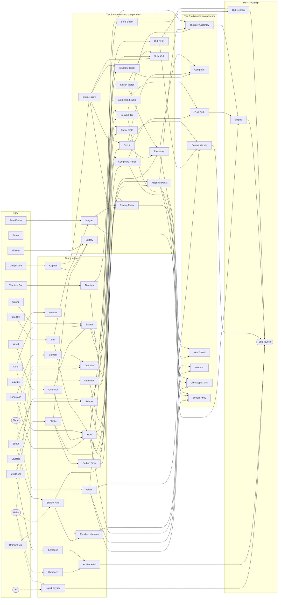

# Telaelus: Game Plan

> Living design document. This is a learning project first and a playable game second.
> This file holds the long-term vision and roadmap (the "why" and "where we are going").
> The **current state** of how each system actually works lives in the blueprints
> (`docs/blueprints/`), which are authoritative for "what is"; how we work is in
> `docs/development.md`. Sections below that duplicate current-state detail are kept for
> context and will be trimmed toward the blueprints over time.

## Goals

1. **Learn by building.** Daniel wants hands-on involvement in the parts worth learning:
   rendering, game loop, systems design, and the math behind a 2.5D world. Prior
   experience: many years of C#, C, and assembly, plus JavaScript-family languages, and a
   pass through basic OpenGL last year.
2. **Stay playable at every stage.** The output is a game you can actually play, not a
   rendered demo video. We prefer vertical slices that run over broad systems that do not.
3. **Keep it incremental.** Build the smallest thing that is fun or instructive, get it
   running, then grow it.

## The Game (concept)

A two-part game sharing one fiction: you keep a fleet of ships fueled and supplied, and you
use that fleet to explore and fight in space. Single-player first, but built with a co-op
multiplayer future in mind (see Architecture Posture).

### Part A: On-Planet (build this first)

A 2.5D game rendered as real 3D geometry under an angled orthographic camera (the Age of
Empires style tilt comes from the camera, not the art). The art is low-poly and flat-colored,
mostly generated by the asset factory; the full style is in [blueprints/art-style.md](blueprints/art-style.md).
Core loop:

- Land on a planet whose map starts hidden (fog of war).
- A **player-controlled character** explores and reveals the map.
- The player builds **extraction facilities** (ore mines, tree harvesters, and similar) on
  resource sites to gather raw resources, and **processing facilities** to refine them.
- **Depot trucks** carry raw resources from collectors to the HQ, and a **hub network** rooted at
  the HQ carries power and supplies to the buildings on it (see Logistics below).
- Refined goods (fuel and other outputs) are loaded back onto the ship.

Think of it as a focused extraction, logistics, and production game (Factorio and
Satisfactory in spirit, plus truck hauling in the vein of Captain of Industry), scoped
down, that feeds the space game.

**Control model (hybrid):**

- A **player character** you drive directly. Its primary early job is exploration (the map is
  dark until explored) and placing buildings, and it is the first hauler: it collects from
  buildings by hand.
- **Facilities** are placed by the player: extraction facilities on resource sites, and
  processing facilities to refine raw resources into intermediates and fuel.
- **Trucks** are the RTS-flavored part. They are not micromanaged: a Depot's trucks dispatch
  themselves to whichever collector needs emptying. Trucks are cheap and slow (slower than the
  player on foot, though they carry far more), bought at a Depot (build more for more throughput:
  one keeps up with about three collectors near the HQ) and later upgradeable (more capacity,
  more speed).

**Logistics model:**

- **The HQ network.** Hubs link buildings to the HQ; everything linked is online and shares the
  one storage and the network's Power, Water, and Sand. Anything not linked is offline, even with
  its own power. Online processors take inputs from storage and put outputs into it directly.
- **Trucks** move raw resources: each truck loops collector to HQ, loading from the collector's
  local buffer and unloading into storage. They serve every collector, online or offline.
- **By hand**: the player can empty any building's buffer into storage, quickly but not
  instantly.
- **Material Transfer** (later research) lets the network carry raw resources from online
  collectors too, so trucks are then needed only for offline outposts and motherlodes.
- There are no belts: the network links buildings that sit close together.

**Decided early specifics:**

- Trucks path **in the simulation** with A* over the fine-cell grid's walkable cells (the
  player's walk rules), avoiding water and obstacles, so movement stays authoritative and
  engine-free. Roads are a later truck speed bonus.
- Buildings are placed on a **tile grid** (grids simplify pathfinding, network coverage, and
  saves). Finer placement can come later if needed.

**Later layers:** procedural terrain and resource distribution (varied planets) sit cleanly on
top of this once the core loop works, so they remain a later layer rather than a day-one need.

#### World: planets, biomes and terrain

The current model (terrain types, biomes, mountain and river features) is in
[blueprints/terrain.md](blueprints/terrain.md). This is the intent it is building toward.

- **Planets weight biomes.** Part A starts on one planet. Each planet has its own biome
  probabilities, so a frozen planet is mostly tundra and becomes the long-term uranium source.
  Procedural generation picks biomes from the planet's weights (see
  [blueprints/world-generation.md](blueprints/world-generation.md)): the world is generated in
  chunks as the player explores, and the player starts on open Grassland with no resources placed
  for them.
- **Signature resources** give each biome a reason to explore and expand. Wood, stone, iron,
  copper, coal, and oil exist now as deposits (see [blueprints/terrain.md](blueprints/terrain.md));
  the rest arrive with later ships and planets:

  | Biome | Signature resources |
  |---|---|
  | Grassland | wood, stone, iron, limestone (starting biome) |
  | Forest | wood in quantity |
  | Highlands | iron, copper, coal, bauxite, limestone, quartz |
  | Desert | oil, sand, copper, bauxite, lithium (the fuel chain) |
  | Swamp | sulfur |
  | Tundra | rare earths, uranium, titanium, quartz |
  | Volcanic | sulfur, crystals, geothermal (end game) |
  | Ocean | water, titanium on the shore, later offshore oil |

- **Two kinds of extraction.** Finite deposits (resource fields) deplete. Terrain-sourced
  resources never run out but need a building on or beside the right terrain: water from a pump
  on ShallowWater, sand from a collector on Sand, power from a geothermal tap at Lava, and a
  water wheel on a river channel (flowing water).
- **Infrastructure reads terrain and features.** Roads go on any walkable land (costlier on Sand,
  Snow, and Mud) and are the only paving; they speed up trucks. Bridges cross ShallowWater, and
  river cells only where the river is Straight, at right angles to its flow. DeepWater, Lava, and
  mountains block both. There are no pipes: the network carries Water.
- **Fixed decisions:** the world is flat (a mountain range is the only hard land barrier); terrain
  is permanent once generated (no landfill); clearing a forest means depleting its Wood fields;
  decorative trees, when they come, never block and are never harvested.

#### Resource tree and economy

The full plan, with the options weighed and the reasons, is
[changesets/completed/2611141757-resource-tree.md](changesets/completed/2611141757-resource-tree.md).
The eight raw resources that exist now are in [blueprints/resources.md](blueprints/resources.md);
everything else here is the plan for later changesets, and every number is a placeholder for
tuning.

**Supply models.** Every resource is **Stored** (counted units in storage, used up per cycle) or
**Capacity** (Power, Water, and Sand: an amount providers put on the network, drawn while a
building runs, never stockpiled). Finite or infinite describes the source, not the model.

**Catalog.** A tier is a stage of the game, not chain depth: items inside a tier can feed each
other in chains of any length. Every recipe has exactly one output.

- **Raw, finite (14):** Wood, Stone, Iron Ore, Copper Ore, Coal, Crude Oil, Bauxite, Limestone,
  Quartz, Titanium Ore, Sulfur, Rare Earths, Uranium Ore, Crystals.
- **Raw, infinite:** Water, Sand, and Power (Capacity); Lithium (Brine Well); air (Air
  Separator).
- **Tier 1, refined:** Iron, Copper, Steel, Glass, Lumber, Charcoal, Cement, Concrete, Kerosene,
  Plastic, Hydrogen, Liquid Oxygen, Aluminum, Silicon, Sulfuric Acid, Rubber, Titanium, Carbon
  Fiber, Rocket Fuel, Enriched Uranium.
- **Tier 2, materials and components:** Hull Plate, Steel Beam, Copper Wire, Circuit, Insulated
  Cable, Machine Parts, Silicon Wafer, Processor, Magnet, Electric Motor, Battery, Solar Cell,
  Composite Panel, Ceramic Tile, Aluminum Frame, Armor Plate.
- **Tier 3, advanced components:** Control Module, Computer, Thruster Assembly, Fuel Tank, Heat
  Shield, Fuel Rod, Life Support Unit, Sensor Array.
- **Tier 4, first ship:** Hull Section, Engine; the launch takes Hull Sections, an Engine, a
  Control Module, Rocket Fuel, and Liquid Oxygen. Lumber and Concrete are building materials.
  Part B's ship parts (and the Laser Lens and Shield Emitter as optional upgrades) wait for its
  style to be chosen.
- **Rocket fuel** is refined kerosene: the Refinery makes Kerosene from Crude Oil, and the Fuel
  Plant treats it with Hydrogen (from water by electrolysis). Liquid Oxygen is a separate launch
  item, from the Electrolyzer early and the Air Separator later. Power is what limits fuel.
- **Travel:** Rocket Fuel engines within a solar system, a later Jump Drive (Crystals and more
  exotic materials) between systems.

Rounded nodes are Capacity resources and dashed arrows Capacity requirements; Steel and Silicon
take Coal or Charcoal.

**Fuel and input pickers.** Fuel is burned in a fuel slot for its own burn time (Coal longest,
then Charcoal, then Wood), separate from recipe inputs. A fuel slot's picker defaults to **Best**
(longest burn in storage); an input with alternatives defaults to **Auto** (whichever storage
holds more of); either can be pinned to one item.

**Storage.** Raw resources have per-type limits, raised by class buildings (Stockyard for solids,
Tank Farm for fluids, Vault for radioactive and precious) and by the Silo, which boosts one chosen
resource and comes first. Manufactured solids share a Warehouse pool measured in **Cargo**. The
HQ gives base capacity in every class. The top bar shows pinned resources.

**Power, Water, and Sand.** Tier-0 buildings need no power; tier 1 and up do, except storage,
hubs, and generators. When demand passes supply, every consumer slows by twice the overload (10%
over is 80% speed) up to 25% over, and past that everything on that resource stops (a blackout)
until the player adds supply or switches buildings off. Readouts show demand over supply: normal
up to supply, yellow in brownout, red in blackout.

**Buffers.** Producing buildings have a small local buffer. Collectors fill it until a truck or
the player empties it; online processors use storage directly; offline ones fill their buffer.
Collecting by hand runs at 10x hand-harvest speed.

**Fields and bypasses.** Fields become fewer and larger (about 4x the amount, a third of the
density). Late-game sources keep the near map useful: a Forester replants Wood, a Quarry beside a
mountain gives Stone and Limestone, Charcoal replaces Coal, a Deep Well keeps a depleted oil seep
pumping slowly, and a Deep Mine works a worked-out ore field forever at a slow rate. **Motherlodes**
are rare, large fields that only these infinite collectors can work, each yielding several
resources by biome (Laterite: Iron Ore and Bauxite; Porphyry: Copper Ore, Iron Ore, Quartz; Coal
Measures: Coal, Iron Ore, Limestone; Salt Dome: Crude Oil and Sulfur; Mineral Sands: Titanium Ore,
Quartz, a little Rare Earths; Massive Sulfide: Sulfur, Copper Ore, Iron Ore). Uranium Ore and
Crystals stay finite on the planet; asteroid mining and other planets supply them later.

**Build order** (one changeset each): storage limits, the HQ network, power, Water and Sand
capacity, Depot trucks, research (with Material Transfer), field rebalance, renewables, then the
production tiers in chain order toward the first ship. Until those land, the placeholder Smelter
(Iron Ore to Iron) and Refinery (Crude Oil to Rocket Fuel) keep the loop playable.

### Part B: In-Space (build this second)

Space exploration and combat. The style is still open:

- Turn-based tactics, or
- Real-time strategy (fleet command), or
- First-person / third-person flying and shooting.

We defer this choice. The on-planet game produces fuel and resources, which gives the space
game its stakes, so Part A is the natural starting point regardless of where Part B lands.

## Scope Discipline

To avoid the classic "huge game, never ships" trap, we define milestones as playable slices.

### Milestone 0: Hello, world (window + loop)

- A window opens, a game loop runs at a stable frame rate, input is read.
- Draw something that moves. This is where the OpenGL refresher happens.

### Milestone 1: A world you can look at and move around

- Render a tile-based ground plane at the 2.5D camera angle.
- Camera pan and zoom.
- A controllable unit or cursor on the ground.

### Milestone 2: Resources exist

- Resource nodes placed on the map.
- A way to designate harvesting and watch a resource count go up.

### Milestone 3: The factory loop

- Place a building that consumes an input resource and produces an output over time.
- A simple production chain: raw -> intermediate -> fuel.
- Enough UI to see inventories and rates.

### Milestone 4: The ship needs fuel

- A ship entity that consumes the fuel you produced.
- A win/continue condition tied to keeping it fueled. This closes the first real game loop.

Later milestones (procedural planets, saving/loading, the space game) come after Milestone 4
proves the core loop is fun.

## Technical Stack

### Decided

- **Engine: Godot 4 (.NET / C# edition).** Chosen for the balance of a higher-level engine
  (built-in game loop via per-frame callbacks, scene tree, editor, physics, audio, UI) with
  an open-source, layered API we can descend into (custom shaders, the low-level
  RenderingDevice) when a topic is worth learning in depth. Being open source means we can
  read the engine itself when we want to understand how something works.
- **Fallback: Unity.** If Godot's C# workflow or tooling gets in the way, Unity is the
  backup (also C#, excellent 2.5D support), accepting its closed source and heavier setup.
- **Language: C#.** Daniel's strongest language and a first-class Godot language.
- **Toolchain: .NET SDK 8 or newer** (required for the Godot C# build). Editor options on
  Windows: Visual Studio, Rider, or VS Code with the C# Dev Kit. We pin the exact Godot 4.x
  version at install time.

### Batteries Godot already includes (we do NOT add libraries for these)

- Rendering (2D and 3D), shaders, scene tree, input mapping, audio, UI, animation.
- TileMap and GridMap for tile / grid worlds (directly relevant to the factory grid).
- Pathfinding: AStarGrid2D, AStar2D, NavigationServer.
- Procedural noise: FastNoiseLite (useful for procedural planets later).
- Math types (Vector2/3, Transform) and scene / resource serialization for saves.

### Libraries and tools to add only when needed (deferred, not day-one)

- **Testing:** a C# test runner such as GdUnit4 or Chickensoft GoDotTest, added at the first
  milestone where automated tests pay off.
- **Live debug UI:** imgui-godot (Dear ImGui for Godot) for inspecting and tweaking a
  systems-heavy game at runtime. Add once the factory has enough knobs to be worth it.
- **Entity scaling:** Godot models entities as scene-tree nodes. A factory game can grow to
  thousands of buildings and trucks. If node overhead becomes a bottleneck, consider a C# ECS (for
  example Arch or Flecs.NET) for the high-count simulation while keeping nodes for
  presentation. This is a known decision point, revisited when counts actually hurt.
- **Saves:** start with Godot's Resource system or System.Text.Json; revisit if state grows
  complex.

## Architecture Posture (multiplayer-ready)

The game ships single-player first but is structured so future multiplayer does not require a
rewrite. The co-op fantasy: one player can spend most of their time on a planet while another
operates in space, and multiple players can converge in space for a large battle. We adopt the
structure below now and write no actual networking code yet.

### Decided

- **Authoritative simulation separated from presentation.** All game state and logic live in a
  simulation that advances on its own tick and owns the truth. Rendering, camera, input, and UI
  are a separate presentation layer that reads the sim and sends it commands. In single-player
  both run in one process (a local server plus a local client). This also makes the sim testable
  without a window and keeps saves clean.
- **Player actions are explicit commands** applied to the sim (for example "build refinery at
  tile X" or "set the Smelter's fuel to Charcoal"), not direct state mutation from
  input handlers. Commands are the natural network message unit later and improve testing and
  replay now.
- **Fixed-timestep simulation tick** (target around 20 to 30 Hz) decoupled from the render
  framerate, so production rates stay consistent and saves / replays are reproducible.
- **One shared session.** The planet (Part A) and space (Part B) are contexts within a single
  simulation / session, not separate games. The fuel and resource handoff between them is shared
  state, not a scene reload.
- **Stable entity IDs and serializable sim state**, kept distinct from Godot presentation nodes.
  This serves saves now and networking later, and dovetails with the possible ECS move if entity
  counts grow.
- **Target networking model: server-authoritative state replication** (Godot's built-in
  high-level multiplayer API: RPC, MultiplayerSynchronizer, MultiplayerSpawner over ENet). We
  deliberately do NOT target deterministic lockstep, so we pay no strict-determinism tax (no
  fixed-point math or deterministic-navmesh requirements).

### Explicitly deferred

Any real network transport, client-side prediction, and interpolation. We build those when
multiplayer actually arrives, on top of the structure above.

## Open Questions

- Space game genre (turn-based / RTS / action).
- Fog of war: how the map is hidden and what reveals it (character proximity, sensor
  buildings).

## How We Work

- Small, running increments over big-bang features.
- Each milestone ends with something playable.
- This document is the source of truth for the plan; we keep it current.
